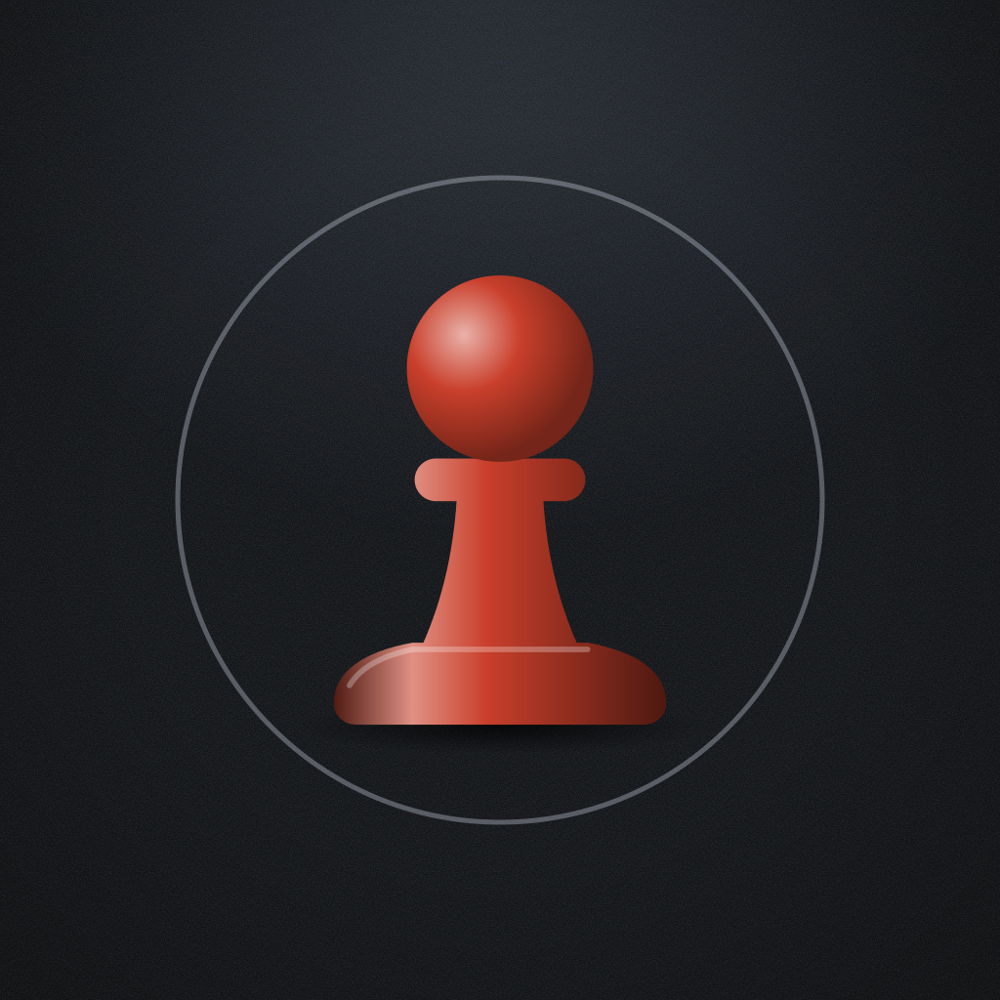

# Leapstone

Leapstone is a free, ad-free Chinese checkers and Halma game for iOS, Android, and the web. Play online against strangers or friends with a per-move timer, solve the daily puzzle, pass the phone around the table, or play offline against the computer on a 3D board rendered in WebAssembly.

- **Web app & rules:** [playleapstone.com](https://playleapstone.com)
- **App Store:** [Leapstone: Chinese Checkers](https://apps.apple.com/app/id6831230722)
- **Google Play:** [Leapstone: Chinese Checkers](https://play.google.com/store/apps/details?id=nl.leapstone.app)

## Features

- **Two classic boards:** Star board (Chinese checkers, 2, 3, 4, or 6 players) and square board (Halma, 2 or 4 players).
- **3D board in WebAssembly:** Built with Bevy and rendered in the browser and native webview.
- **Live online multiplayer:** Quick matchmaking by Elo rating, friend invites via link, friend list and challenges, live WebSocket updates, and server-authoritative move validation on Cloudflare Workers + Durable Objects.
- **Offline play:** Pass-and-play on one device, three computer difficulty levels, and a deterministic daily puzzle with streak tracking.
- **No accounts or tracking:** Just a player name and a recovery code. No ads, no analytics, and no passwords.

## Architecture

| Path | Description |
| --- | --- |
| `crates/halma-core` | Board geometry, move rules, jump chains, computer opponent, and daily puzzles (Rust + WASM). |
| `crates/halma-bord3d` | 3D board, pieces, camera, and table controls built with Bevy (Rust + WASM). |
| `crates/halma-opslag` | Storage layer for players, games, ratings, chat, friends, and challenges (SQLite / Durable Object SQL). |
| `crates/halma-push` | Web Push (VAPID / `aes128gcm`) and Apple Push Notification service (APNs) helpers. |
| `crates/leapstone-worker` | Cloudflare Worker HTTP/WebSocket API and Durable Object backend. |
| `crates/halma-app` | Tauri 2 mobile wrapper for iOS and Android. |
| `web/` | Svelte 5 + TypeScript + Vite frontend, 43+ localized UI tables, landing pages, and rules guides. |

## Prerequisites

- **Rust** (stable toolchain via [rustup](https://rustup.rs/)); `rust-toolchain.toml` automatically adds the `wasm32-unknown-unknown` target.
- **Node.js** 22 or newer (24 LTS recommended) and **npm**.
- **Linux system libraries** (only required when compiling/testing the `halma-app` Tauri crate on Linux):
  ```sh
  sudo apt-get install -y build-essential pkg-config xz-utils \
    libssl-dev libwebkit2gtk-4.1-dev libgtk-3-dev libsoup-3.0-dev \
    libayatana-appindicator3-dev librsvg2-dev libxdo-dev
  ```

## Quick Start

Clone the repository and install web dependencies:

```sh
git clone https://github.com/wimjan123/leapstone.git
cd leapstone
npm --prefix web ci
```

### Run the web app locally

Build the core rules WASM and the 3D board WASM, then start the Vite dev server:

```sh
npm --prefix web run wasm
npm --prefix web run wasm3d:snel
npm --prefix web run dev
```

Open the URL printed by Vite (default `http://localhost:5173`).

> **Note:** `wasm3d:snel` builds a fast development version of the 3D board. For an optimized production bundle, run `npm --prefix web run wasm3d` instead.

### Run the multiplayer backend locally

Install root dev dependencies (for `wrangler`) and start the local Cloudflare Worker with an ephemeral local Durable Object database:

```sh
npm ci
npm run worker:dev
```

The Worker listens on `http://127.0.0.1:8787`, which Vite proxies automatically for `/api` requests.

### Run the tests

Fast checks for the part you are working on:

```sh
# Rust game rules and AI tests
cargo test -p halma-core

# Rust storage tests with SQLite
cargo test -p halma-opslag --features rusqlite

# Web / Svelte unit tests (builds halma-core WASM first)
npm --prefix web test
```

Full verification suite (Rust workspace tests, SQLite storage tests, WASM build, `svelte-check`, production site build, Vitest suite, and timing benchmark):

```sh
scripts/volledige-check.sh
```

### Building the mobile apps (optional)

- **Android:** Install Android SDK + NDK and add the Rust Android targets (`rustup target add aarch64-linux-android armv7-linux-androideabi x86_64-linux-android i686-linux-android`), then run `npm ci && npm run app:android:build` for a debug APK.
- **iOS:** Requires macOS and Xcode. Run `npm ci && npx tauri ios init --ci` followed by `npx tauri ios build`.

## Contributing

Contributions are welcome. Please read [CONTRIBUTING.md](CONTRIBUTING.md) before opening a pull request, and follow our [Code of Conduct](CODE_OF_CONDUCT.md).

## Security

To report a security vulnerability, please see [SECURITY.md](SECURITY.md).

## License

Copyright (c) 2026 William Visser.

Leapstone is licensed under the **GNU Affero General Public License v3.0 only** (`AGPL-3.0-only`). See [LICENSE](LICENSE) for the full text.

### Third-party notices

- Subsetted Noto Sans Bold fonts in `web/src/assets/fonts/knop/` are licensed under the [SIL Open Font License 1.1](https://openfontlicense.org/).
- Rust and JavaScript dependencies remain under their respective open-source licenses (see `Cargo.lock`, `package-lock.json`, and `web/package-lock.json`).
